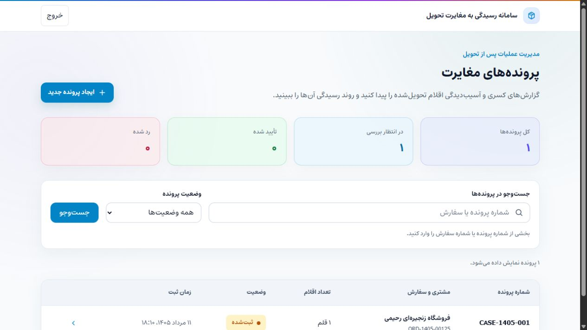
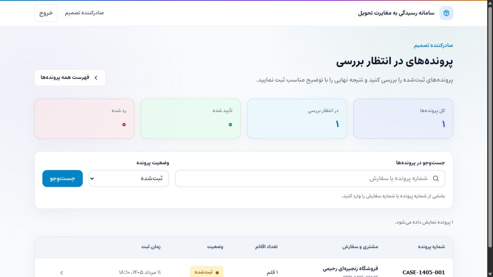

# Delivery Discrepancy Manager

An internal case-management system for tracing, reviewing, and resolving shortages and damaged items reported after order delivery.

**Problem:** Operations teams need a reliable way to connect a customer complaint to the correct delivered order, record the affected items with exact quantities, and keep the final decision traceable for audit purposes.

**Solution:** A role-based web application where operators search delivered orders, create discrepancy cases with multi-item validation, and assign them for review. Managers approve or reject with a mandatory explanation. Every action is recorded in an immutable audit trail.

**Users:**

- **Operators:** Search orders, create cases, claim/release assignments
- **Managers:** Review submitted cases, approve or reject with explanation, trace complete history

## What You'll See in 10 Minutes

- **Real business logic:** Not CRUD. Order eligibility, quantity validation, duplicate prevention with case linking, atomic claim/release, and immutable audit trail.
- **Database-enforced integrity:** Composite primary key on `OpenDiscrepancy`, check constraints on quantities and explanations, `SERIALIZABLE` transactions for concurrent operations.
- **Working demo:** Deterministic seed data, one-command startup, documented credentials, step-by-step demo script.
- **Full-stack implementation:** React 19 + NestJS + PostgreSQL with TypeScript end-to-end. Persian RTL localization.
- **Access boundaries:** Pre-provisioned accounts, JWT authentication, role-based guards, CORS locked to frontend origin, and scrypt password hashing.
- **Business logic:** Order eligibility, quantity validation, duplicate prevention, assignment conflict handling, and immutable history are enforced server-side.

## Product Screenshots

### Operator Case Workflow

Case overview with status summaries, search, filtering, and case creation access.



### Manager Review

Submitted-case queue for final manager review.



---

## Quick Start

```bash
# Prerequisites: Node.js 20.20+, pnpm 10.34.5, Docker Desktop
git clone <repository-url>
cd delivery-discrepancy-manager
pnpm install
pnpm setup:local
pnpm db:setup
pnpm dev
```

> **Note:** `pnpm setup:local` creates `backend/.env` from `.env.example` with a randomly generated `JWT_SECRET` if it doesn't already exist. An existing `.env` is never overwritten.

| Service    | URL                       |
| ---------- | ------------------------- |
| Frontend   | http://localhost:5173     |
| API        | http://localhost:3000/api |
| PostgreSQL | localhost:5433            |

`pnpm dev` starts both frontend and backend concurrently.

---

## Demo Credentials

| Role         | Email                 | Password   |
| ------------ | --------------------- | ---------- |
| **OPERATOR** | `operator@local.test` | `Demo123!` |
| **MANAGER**  | `manager@local.test`  | `Demo123!` |

---

## 10-Minute Demo Script

Follow these exact steps to see the most impressive features.

### Step 1: Login as Operator

- Open http://localhost:5173/login
- Enter `operator@local.test` / `Demo123!`
- Click "ورود به سیستم"
- Expected: Redirect to dashboard, header shows "خروج" button

**Why this matters:** Proves JWT authentication works and the frontend stores the token correctly.

### Step 2: Create a New Case

- Click "ثبت پرونده جدید"
- Search `ORD-1405-00127`
- Expected: Order card shows green badge "قابل ثبت پرونده" with 3 items (Rice, Oil, Detergent)
- Click the order card
- Toggle "کسری" for Rice, enter quantity `2`
- Toggle "خسارت" for Oil, enter quantity `3`
- Click "ثبت پرونده"
- Expected: Redirect to case details with case number (e.g., `CASE-001002`) and status "ثبت‌شده"

**Why this matters:** Proves order eligibility validation, multi-item case creation, quantity validation, and that the backend creates the case with `OpenDiscrepancy` markers and `CREATED` history event.

### Step 3: Claim, Release, Claim Again

- Click "درخواست انتساب"
- Expected: Button changes to "آزادسازی انتساب", assignee name appears
- Click "آزادسازی انتساب"
- Expected: Button reverts, assignee cleared
- Click "درخواست انتساب" again
- Expected: Assignment succeeds

**Why this matters:** Proves atomic claim/release operations with `SERIALIZABLE` transaction isolation. Two simultaneous claims would conflict; the `updateMany` with status + assignee check prevents double-claim.

### Step 4: Trigger Duplicate Prevention

- Click "ثبت پرونده جدید"
- Search `ORD-1405-00125`
- Expected: Shows same 3 items but with existing open discrepancy (Rice SHORTAGE)
- Click the order card
- Toggle "کسری" for Rice, enter quantity `1`
- Click "ثبت پرونده"
- Expected: 409 error with message "برای بخشی از اقلام انتخاب‌شده پرونده باز وجود دارد." and a clickable link to existing case `CASE-1405-001`

**Why this matters:** Proves the `OpenDiscrepancy` composite primary key `[orderItemId, type]` prevents duplicate cases at the database level. The backend returns the existing case number for navigation.

### Step 5: Manager Review

- Click "خروج" in header
- Login as `manager@local.test` / `Demo123!`
- Expected: Header shows "صادرکننده تصمیم" link
- Click "صادرکننده تصمیم"
- Expected: Review queue shows SUBMITTED cases
- Open the case created in Step 2
- Enter explanation: "مغایرت تأیید شد."
- Click "تأیید پرونده"
- Expected: Success message, status changes to "تأیید شده", decision summary appears

**Why this matters:** Proves role-based authorization (`@Roles('MANAGER')`), decision creation, and that the backend cleans up `OpenDiscrepancy` records after decision.

### Step 6: Verify Audit Trail

- Scroll to "تاریخچه پرونده" section
- Expected: Timeline shows events in order:
  1. CREATED → SUBMITTED (by operator)
  2. ASSIGNED → SUBMITTED (by operator)
  3. ASSIGNMENT_RELEASED → SUBMITTED (by operator)
  4. ASSIGNED → SUBMITTED (by operator)
  5. DECIDED → APPROVED (by manager)

**Why this matters:** Proves the immutable `CaseHistory` table records every state transition with actor attribution and timestamp.

### Step 7: Test Invalid Token

- Open DevTools → Application → Local Storage
- Modify `auth_token` to `invalid.token.here`
- Refresh the page
- Expected: Redirect to `/login`, `auth_token` removed from localStorage

**Why this matters:** Proves the centralized 401 handler in `services/index.ts` clears stale tokens and redirects to login.

### Step 8: Test Forbidden Operator Action

- Login as operator again
- Open any SUBMITTED case
- Expected: No approve/reject buttons visible
- Open DevTools Console, run:

```javascript
fetch('/api/cases/' + window.location.pathname.split('/').pop() + '/decision', {
  method: 'POST',
  headers: {
    Authorization: 'Bearer ' + localStorage.getItem('auth_token'),
    'Content-Type': 'application/json',
  },
  body: JSON.stringify({ type: 'APPROVE', explanation: 'test' }),
});
```

- Expected: 403 Forbidden

**Why this matters:** Proves backend `RolesGuard` enforces authorization even when a client bypasses UI restrictions.

---

## Business Rules

### Order Eligibility

**Business Problem:** Cannot create a discrepancy case on an order that hasn't been delivered or has no items.

**Business Rule:** Order status must be `DELIVERED` and must have at least one `OrderItem` with `deliveredQuantity > 0`.

**Implementation:** `OrdersService.search()` returns eligibility flag. `CasesService.create()` enforces eligibility server-side before creating case.

**Database Guarantee:** None — eligibility is application logic. The database only stores what it receives.

---

### Quantity Validation

**Business Problem:** Operators must not claim more items than were delivered, either per-item or across multiple discrepancy types.

**Business Rule:**

- Each discrepancy quantity must be a positive integer
- Individual quantity cannot exceed `deliveredQuantity` for that order item
- Combined quantity across all discrepancy types for one item cannot exceed `deliveredQuantity`

**Implementation:** `validateCaseItemsAgainstOrder()` checks individual and combined totals. Returns structured validation issues with field-level errors.

**Database Guarantee:** `discrepancy_item_quantity_positive` check constraint ensures no non-positive quantities at the database level.

---

### OpenDiscrepancy Conflict Detection

**Business Problem:** Two operators could independently create the same discrepancy claim for the same order item, causing duplicate work and conflicting decisions.

**Business Rule:** Only one open `SHORTAGE` or `DAMAGED` discrepancy is allowed per order item. Attempting to create a duplicate returns 409 with the existing case number.

**Implementation:** `OpenDiscrepancy` table with composite primary key `[orderItemId, type]`. Checked during case creation before inserting.

**Database Guarantee:** `@@id([orderItemId, type])` unique constraint ensures only one open discrepancy per item+type. Concurrent inserts will cause one to fail with `P2002`.

---

### Case Assignment (Claim/Release)

**Business Problem:** Multiple operators might try to claim the same case simultaneously, or an operator might release a case they don't own.

**Business Rule:** Only unassigned SUBMITTED cases can be claimed. Only the current assignee can release. Both operations are atomic.

**Implementation:** `claimCase()` and `releaseCase()` use `updateMany` with `where` clause checking `status` and `assigneeId`. Wrapped in `SERIALIZABLE` transaction.

**Database Guarantee:** `updateMany` returns count of affected rows. If count !== 1, the operation throws `CASE_ASSIGNMENT_CONFLICT`. The `where` clause ensures atomic check-and-update.

---

### Manager Decision

**Business Problem:** A manager must provide an explanation for every approval or rejection. The decision must be final and immutable.

**Business Rule:** Only managers can approve or reject SUBMITTED cases. Explanation is mandatory. Decision cannot be changed once made.

**Implementation:** `CasesService.decide()` validates input, checks case is SUBMITTED, creates `CaseDecision`, deletes `OpenDiscrepancy` records, creates `CaseHistory` event. All in one `SERIALIZABLE` transaction.

**Database Guarantee:** `decision_explanation_not_blank` check constraint prevents empty explanations. `CaseDecision` has unique `caseId` ensuring one decision per case.

---

### Immutable Audit Trail

**Business Problem:** Every action on a case must be attributable to a specific operator with a timestamp for compliance and accountability.

**Business Rule:** Every state change (create, assign, release, decide) creates exactly one `CaseHistory` record. History cannot be modified or deleted.

**Implementation:** Append-only inserts on every state transition. `CaseHistory` stores `eventType`, `resultingStatus`, `performedById`, and `createdAt`.

**Database Guarantee:** `CaseHistory` has no update or delete endpoints. Foreign keys to `Operator` ensure attribution even if case is archived. Index on `[caseId, createdAt]` for timeline queries.

---

## Engineering Decisions & Trade-offs

### NestJS

**Why:** Modular architecture with built-in dependency injection, guards, and Passport integration. The `@Roles()` decorator and `RolesGuard` pattern makes role-based access explicit and testable.

**Trade-off:** Adds ceremony compared to Express, but enforces structure that scales.

**Typical Interview Question:** "Why NestJS over Express or Next.js API routes?"

---

### Prisma ORM

**Why:** Compile-time type safety, migrations for schema evolution, and clear mapping between schema and code. Composite PKs and check constraints are expressed directly in the schema.

**Trade-off:** Abstraction over SQL. Raw SQL is used only for the case number sequence lookup because Prisma lacks a sequence helper.

**Typical Interview Question:** "Why Prisma over raw SQL or TypeORM?"

---

### PostgreSQL

**Why:** Strictest transactional guarantees. `SERIALIZABLE` isolation, `ENUM` types, composite PKs, and check constraints enforce business rules at the database level.

**Trade-off:** More operational complexity than MySQL or SQLite, but data integrity is non-negotiable.

**Typical Interview Question:** "Why PostgreSQL over MySQL for this workload?"

---

### React + TypeScript + Vite

**Why:** Fast HMR, large ecosystem, TypeScript catches UI bugs in a data-heavy interface.

**Trade-off:** No SSR, but not needed for an internal tool.

**Typical Interview Question:** "Why React over Vue or Svelte for an internal tool?"

---

### TanStack Query

**Why:** Handles server state lifecycle automatically. Cache invalidation after mutations keeps list and detail views in sync without manual state management.

**Trade-off:** Learning curve, but eliminates boilerplate compared to Redux.

**Typical Interview Question:** "Why TanStack Query over Redux or Zustand?"

---

### JWT Authentication

**Why:** Stateless API auth. No server-side session storage required. Tokens contain operator ID and role.

**Trade-off:** Tokens cannot be invalidated before expiry. Acceptable for low-volume internal tool; production would use refresh tokens.

**Typical Interview Question:** "When would you use sessions instead of JWT?"

---

### localStorage Token Storage

**Why:** Simplest client-side persistence for a portfolio. Survives page refreshes without server coordination.

**Trade-off:** Vulnerable to XSS. httpOnly cookies are more secure but require refresh tokens and CSRF protection. This is a deliberate MVP trade-off.

**Typical Interview Question:** "What's the security risk of storing JWT in localStorage?"

---

### OpenDiscrepancy Table

**Why:** A materialized conflict marker with composite PK `[orderItemId, type]`. Turns a complex join query into an O(1) uniqueness check.

**Trade-off:** Extra table to maintain, but enforces the business rule at the database level and makes conflict detection atomic.

**Typical Interview Question:** "Why a separate table instead of querying existing cases?"

---

### Immutable Cases

**Why:** Simplifies the state machine and audit trail. No edit history, no optimistic locking, no partial state corruption.

**Trade-off:** Mistakes are permanent. In production, a DRAFT status or cancel-and-replace workflow would address this.

**Typical Interview Question:** "Why can't operators edit submitted cases?"

---

### SERIALIZABLE Transactions

**Why:** Prevents lost updates during concurrent claim/release and decision operations. Two operators reading `assigneeId=null` simultaneously is a classic race condition.

**Trade-off:** Higher serialization failure rate under load. Acceptable for a low-volume, human-paced workflow.

**Typical Interview Question:** "What isolation level should you use for financial transactions and why?"

---

### Case History as Separate Table

**Why:** Queryable, filterable, and indexable. Foreign keys ensure history entries reference real operators even if cases are archived.

**Trade-off:** More joins than a JSON column, but enables independent queries like "show all decisions by this manager."

**Typical Interview Question:** "Why store audit history in a separate table instead of a JSON column on the case?"

---

## Security Verification

### Authentication

```bash
# Login returns JWT
curl -X POST http://localhost:3000/api/auth/login \
  -H "Content-Type: application/json" \
  -d '{"email":"operator@local.test","password":"Demo123!"}'
# Expected: 200 with access_token
```

### Authorization

```bash
# Operator trying manager endpoint
curl -X POST http://localhost:3000/api/cases/{caseId}/decision \
  -H "Authorization: Bearer <operator_token>" \
  -H "Content-Type: application/json" \
  -d '{"type":"APPROVE","explanation":"test"}'
# Expected: 403 Forbidden
```

### Unauthenticated Access

```bash
# No token
curl http://localhost:3000/api/cases
# Expected: 401 Unauthorized
```

### CORS

- Backend locked to `FRONTEND_ORIGIN` from environment
- Vite proxy is development-only

### Password Storage

- scrypt with random 16-byte salt, 64-byte key
- Never returns password hash in API responses

### Known Trade-offs

- JWT stored in localStorage (XSS risk). httpOnly cookies would be preferable in production but require refresh tokens and CSRF protection.
- No rate limiting or security headers. Acceptable for a portfolio; required for production.

---

## Production Limitations

This is a portfolio project. These are the deliberate gaps:

| Limitation                | Why It Exists                                 | Production Fix                               |
| ------------------------- | --------------------------------------------- | -------------------------------------------- |
| JWT in localStorage       | Simplest MVP implementation                   | httpOnly cookies + refresh tokens            |
| No refresh token flow     | Portfolio scope                               | Short-lived access tokens + refresh endpoint |
| No automated test suite   | Kept the portfolio scope focused              | Add unit, integration, and E2E coverage      |
| CasesService is 827 lines | Prioritized feature delivery over refactoring | Split into query/command services            |
| No rate limiting          | Not required for demo                         | Express middleware or Cloudflare             |
| No CI/CD                  | Portfolio, not deployment                     | GitHub Actions                               |
| No monitoring             | Portfolio, not operations                     | Sentry or similar                            |

---

## What This Project Demonstrates

- **Full-stack capability:** React 19 + NestJS + PostgreSQL with TypeScript end-to-end
- **Business logic:** Not a CRUD clone. Real rules: eligibility, quantity validation, duplicate prevention, assignment workflow, immutable audit trail
- **Database maturity:** Composite PKs, check constraints, foreign keys with RESTRICT, SERIALIZABLE transactions, indexes on query patterns
- **Concurrency awareness:** Atomic claim/release with `updateMany`, conflict detection at the database level
- **User experience:** Persian RTL localization, responsive design, role-aware UI, deterministic demo
- **Reviewer experience:** One-command setup, `pnpm db:verify`, deterministic seed with documented credentials
- **Honesty:** Documents trade-offs explicitly. Knows what's missing and why.

---

## Available Commands

```bash
pnpm setup:local       # Create backend/.env from .env.example if missing
pnpm db:start          # Start PostgreSQL
pnpm db:stop           # Stop PostgreSQL
pnpm db:seed           # Seed development data
pnpm db:verify         # Verify database integrity
pnpm db:setup          # Start + deploy migrations + seed + verify
pnpm dev               # Start frontend and backend
pnpm check             # Lint + typecheck + build + format:check
pnpm lint              # Oxlint
pnpm typecheck         # TypeScript check
pnpm build             # Production build
pnpm format            # Format files with Prettier
pnpm format:check      # Check formatting with Prettier
```
